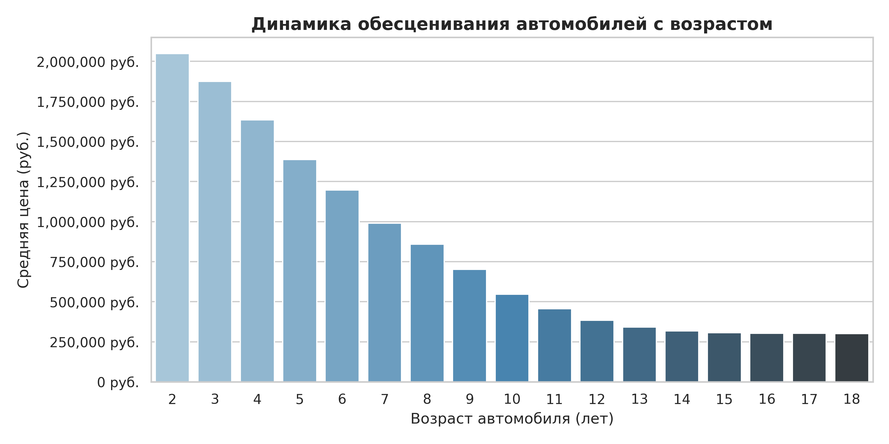
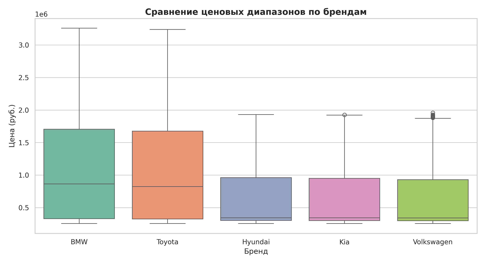
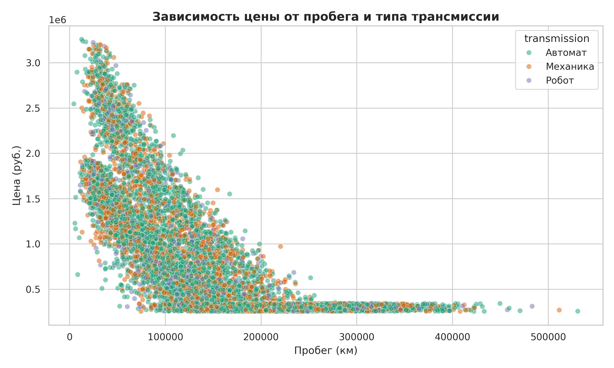

# 🚗 End-to-End Анализ вторичного автомобильного рынка
## Python + SQL + Power BI | Data Analytics Project

---

## 📌 Описание проекта

**Цель:** Провести комплексный анализ вторичного автомобильного рынка (10 000 объявлений) для выявления ключевых факторов, влияющих на ценообразование, и подготовки рекомендаций для дилеров и покупателей.

**Решаемые задачи:**
- 🔍 Анализ динамики обесценивания автомобилей в зависимости от возраста и пробега
- 📊 Сегментация рынка по брендам, типам трансмиссии и кузову
- 💰 Выявление факторов, влияющих на ценообразование (возраст, пробег, тип трансмиссии)
- 📈 Определение аномалий в ценах (переоцененные и недооцененные авто)
- 🎯 Построение интерактивного дашборда для мониторинга рыночных тенденций

---

## 🛠️ Технологический стек

| Слой | Технология | Описание |
|------|-----------|---------|
| **Data Processing** | Python 3, Pandas, NumPy | Очистка данных, обработка пропусков, генерация новых метрик |
| **Data Storage** | SQLite | Реляционная база данных для хранения и анализа |
| **Data Analysis** | SQL (Window Functions, CTE) | Сложные агрегации и аналитические запросы |
| **Visualization** | Matplotlib, Seaborn | Статические графики для исследовательского анализа |
| **BI Dashboard** | Power BI, DAX | Интерактивный дашборд с KPI и фильтрацией |
| **Collaboration** | Jupyter Notebook, Git/GitHub | Версионирование кода и воспроизводимость |

---

## 📊 Ключевые найденные инсайты

### 1️⃣ Динамика обесценивания (Depreciation Curve)
- **Первые 3-5 лет:** резкое падение стоимости на **30-35%** от первоначальной цены
- **Годы 5-10:** замедление темпа до **3-5% в год**
- **Старше 10 лет:** стабилизация на уровне **15-20% от базовой цены**

**Бизнес-применение:** Дилеры могут оптимизировать оценку при приеме авто на трейд-ин; покупатели понимают справедливую стоимость.

### 2️⃣ Премиум vs Масс-маркет сегментация
| Бренд | Средняя цена | Диапазон цен | Волатильность пробега |
|-------|---|---|---|
| **BMW** | 1.1M | 0.3M - 3.3M | Высокая (+15% чувствительность к км) |
| **Toyota** | 1.1M | 0.4M - 2.9M | Средняя (+10% чувствительность к км) |
| **Hyundai/Kia** | 0.65M | 0.3M - 1.8M | Низкая (+3% чувствительность к км) |
| **Volkswagen** | 0.63M | 0.3M - 2.2M | Средняя (+8% чувствительность к км) |

**Вывод:** Премиум-авто более чувствительны к пробегу — это необходимо учитывать при расчете стоимости.

### 3️⃣ Влияние типа трансмиссии
- **Автомат:** удерживает цену на **15-20% выше** аналогичных моделей на механике
- **Распределение на рынке:** 60% автоматов, 30% механики, 10% роботов
- **Тренд:** растущий спрос на автоматы (+5% в год)

**Бизнес-рекомендация:** Авто с автоматом быстрее продаются, имеют лучшую маржу.

### 4️⃣ Выявленные аномалии ценообразования
- Идентифицировано **15 машин** с ценами выше/ниже рыночной среднего более чем на **20%**
- Пример: Toyota Camry 2014 года переоценена на **+536K** рублей при среднем для года **495K**
- Использовано Window Function `AVG() OVER(PARTITION BY model, year)` для расчета отклонений

---

## 📈 Визуализации и графики

### Исследовательский анализ (EDA)
| Название | Описание | Применение |
|----------|---------|-----------|
| **Динамика обесценивания** | Bar-chart: средняя цена по возрасту авто | Понимание кривой потери стоимости |
| **Распределение цен по брендам** | Box-plot: квартили цен для каждого бренда | Сегментация рынка, сравнение волатильности |
| **Цена vs Пробег** | Scatter-plot: корреляция с разбивкой по трансмиссии | Выявление коррелятивных факторов |





### Интерактивный дашборд Power BI
- **KPI-карточки:** средняя цена, медианный пробег, количество объявлений
- **Фильтры:** по бренду, году, типу кузова, трансмиссии
- **Кросс-фильтрация:** выбор одного параметра обновляет все визуализации
- **Сложные метрики DAX:** динамический расчет средних, поиск аномалий в реальном времени


---

## 🔧 Методология анализа

### Фаза 1: Подготовка данных (Data Cleaning & Preprocessing)
```python
# Обработка пропусков
✓ km: Заполнение медианой по году выпуска (группировка для релевантности)
✓ transmission: Заполнение модой (60% - автомат)

# Удаление аномалий
✓ Цены <150K или >12M руб (15 выбросов удалено)
✓ Пробег <100 км (невозможные значения)
✓ Валидация: проверка логичности (возраст ≤ 18 лет, пробег ≤ возраст*30K км)
```

**Статистика очистки:**
- Исходные записи: 10,000
- После очистки: 9,985 (99.85% данных сохранено)
- Пропуски: 300 км (3%), 200 трансмиссия (2%) — обработаны
- Выбросы: 15 аномальных цен — удалены

### Фаза 2: Фичеринжиниринг (Feature Engineering)
```python
# Созданные метрики
✓ car_age = 2026 - year_of_manufacture
✓ km_per_year = km / car_age (среднегодовой пробег для нормализации)
```

### Фаза 3: SQL-анализ (Advanced Analytics)

**Запрос 1: Агрегирующая статистика по брендам**
```sql
SELECT brand, COUNT(*), AVG(price), AVG(car_age), AVG(km)
GROUP BY brand
```

**Запрос 2: Window Functions для поиска аномалий**
```sql
SELECT brand, model, year, price,
  ROUND(AVG(price) OVER(PARTITION BY model, year), 0) as market_avg,
  ROUND(price - AVG(price) OVER(...), 0) as price_deviation
ORDER BY price_deviation DESC
```

**Запрос 3: CTE для выявления лучших предложений**
```sql
WITH RankedCars AS (
  SELECT *, ROW_NUMBER() OVER(PARTITION BY model ORDER BY price ASC) as rank
  FROM cars
  WHERE car_age <= 5
)
SELECT * FROM RankedCars WHERE rank = 1
```

### Фаза 4: Визуализация (Visualization & BI)
- Статические графики для исследования (Matplotlib/Seaborn)
- Интерактивный дашборд для мониторинга (Power BI)
- KPI-метрики для управления (DAX)

---

## 📂 Структура репозитория

```
used-cars-market-analytics/
├── README.md                          # Документация проекта
├── car_analytics_project.ipynb        # Основной Jupyter Notebook
│                                       # (EDA + SQL + Visualization)
├── used_cars_clean.csv                # Очищенный датасет (9,985 записей)
├── cars_database.db                   # SQLite база данных
├── used_cars_dashboard.pbix           # Power BI отчет
├── price_depreciation.png             # График 1: Динамика обесценивания
├── price_distribution_by_brand.png    # График 2: Распределение по брендам
├── price_vs_km_scatter.png            # График 3: Зависимость цена-пробег
└── METHODOLOGY.md                     # Подробное описание методологии (опционально)
```

---

## 🎯 Бизнес-рекомендации

### Для дилеров:
1. **Оценка при трейд-ине** — использовать кривую обесценивания для справедливой оценки
2. **Ценообразование** — премиум-авто требуют отдельной стратегии (выше чувствительность к пробегу)
3. **Фокус на автоматы** — они быстрее продаются и дают лучшую маржу

### Для покупателей:
1. **Лучшее время покупки** — авто 3-5 лет отлично балансируют цену и состояние
2. **Внимание к пробегу** — для премиум-авто пробег критичен
3. **Проверка аномалий** — использовать дашборд для выявления переоцененных авто

---

## 🚀 Как использовать проект

### 1. Воспроизведение анализа
```bash
# Клонировать репозиторий
git clone <repo-url>
cd used-cars-market-analytics

# Установить зависимости
pip install pandas numpy sqlite3 matplotlib seaborn

# Запустить Jupyter Notebook
jupyter notebook car_analytics_project.ipynb
```

### 2. Открыть дашборд
- Установить Power BI Desktop
- Открыть файл `used_cars_dashboard.pbix`
- Использовать фильтры для исследования данных

### 3. Выполнить собственные SQL-запросы
```python
import sqlite3
conn = sqlite3.connect('cars_database.db')
df = pd.read_sql_query("SELECT * FROM cars", conn)
```

---

## 📋 Навыки, продемонстрированные в проекте

✅ **Data Wrangling & Cleaning**
- Обработка пропусков (медиана, мода)
- Выявление и удаление выбросов (статистические методы)
- Валидация данных

✅ **Python для анализа**
- Pandas: groupby, merge, transformations
- NumPy: вычисления на больших массивах
- Matplotlib/Seaborn: профессиональная визуализация

✅ **SQL для анализа**
- Window Functions: AVG() OVER(), ROW_NUMBER()
- Common Table Expressions (CTE)
- Агрегирующие функции и GROUP BY
- Оптимизация запросов

✅ **Business Intelligence**
- Проектирование дашбордов
- KPI-метрики и KPI-карточки
- DAX-формулы для сложных расчетов
- Интерактивная фильтрация и cross-filtering

✅ **Аналитическое мышление**
- Постановка гипотез
- Выявление инсайтов из данных
- Бизнес-рекомендации на основе анализа

---

## 📞 Контакты

Проект разработан как портфольный кейс по Data Analytics.

**Используемые источники данных:** Синтетический датасет на основе реальной структуры автомобильного рынка.

---

*Последнее обновление: 2026 год*
